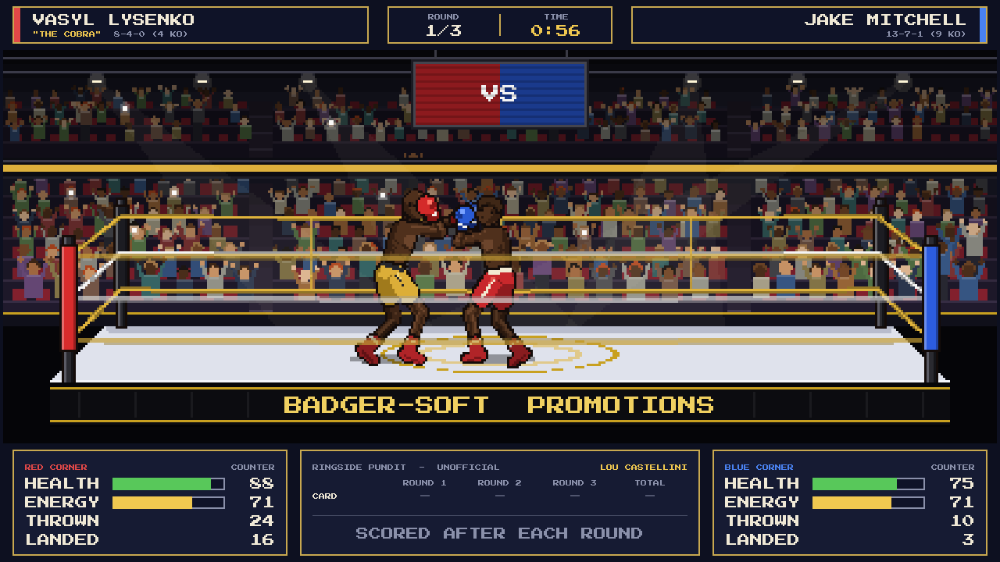
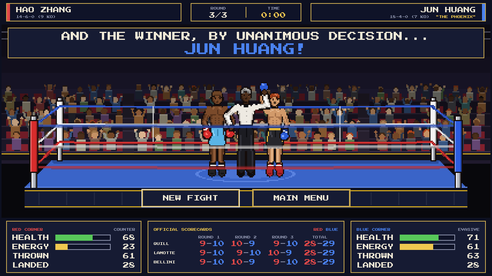
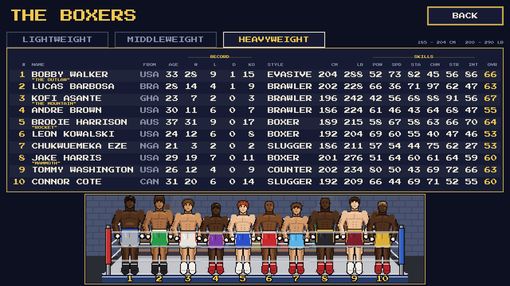
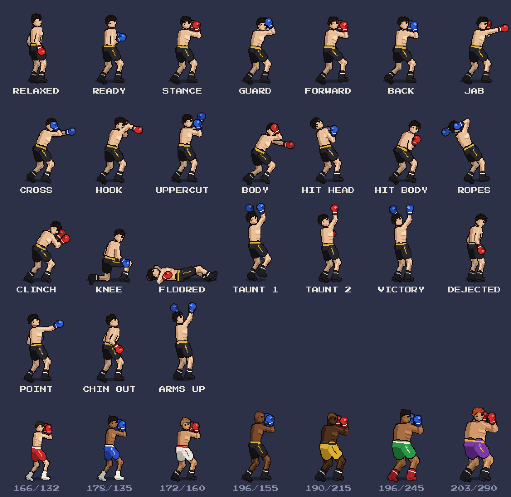

# International Boxing Manager 2027

*by Badger-soft*

An ode to *Barry McGuigan World Championship Boxing* (Commodore 64, 1985),
drawn in a 16-bit Amiga style but keeping the classic side-on view of the
ring. Built with **Godot 4.7** for PC and mobile.

This is the first build. It concentrates on the ring, the boxers and a fight
that plays itself out logically. There is no human trainer yet: both corners
are run by the AI.



---

## Running it

1. Install [Godot 4.7](https://godotengine.org/download) (the standard build;
   no C#/.NET needed).
2. Open Godot, choose **Import**, and select `project.godot` in this folder.
3. Press **F5** (Run Project).

Controls:

| Action                      | PC                   | Mobile        |
|-----------------------------|----------------------|---------------|
| Start / choose a button     | Mouse or Enter       | Tap           |
| Skip the tale of the tape   | Click, Space, Enter  | Tap           |
| Skip the judges' read-out   | Click, Space, Enter  | Tap           |
| Back to the main menu       | Esc                  | Back button   |

The project uses the **Compatibility** renderer so the same build runs on
desktop and on low-end phones. To make a phone build, install the Android
export templates from *Editor > Manage Export Templates* and add an Android
preset under *Project > Export*.

---

## What happens in a fight

* A weight division, two of its boxers and one of the four
  venues (Small Town Gym, City Gym, Boxing Hall, Grand Arena) are picked at
  random.
* The **tale of the tape** compares them. Tap, or wait 12 seconds, to ring the
  bell.
* Three rounds. Each round is **1 minute of real time**, but the clock shows
  **3:00** and counts down at three times real speed.
* The **bell** rings to start each round, and three times to end it.
* Between rounds the boxers walk back to their corners. Each trainer picks
  one of four instructions (*attack more*, *defend more*, *keep it up*,
  *go all out*), and it appears in a speech bubble. It changes how the boxer
  fights the next round.
* Punches can land clean, be slipped, or be **blocked**. A boxer who covers
  up blocks most head shots (and catches some body shots on his elbows);
  how well depends on his intelligence and speed against the puncher's
  intelligence.
* Now and then a **big punch** lands: far more damage, twice the chance of a
  knockdown, a flash where it lands, a heavy thud and the crowd roaring in
  anticipation. They are rare (one or two per boxer in a fight) and come
  from a run of clean punches, an opponent running out of gas, a dropped
  guard (hurt, showboating or hands down) or a good counter; harder
  punchers and smarter boxers make more of them.
* Knockdowns get a count. A boxer may make it to one knee and then stand, or
  stay down. Three knockdowns in one round stops the fight.
* When the fight ends, both boxers and the referee turn to face the crowd in
  the middle of the ring, the referee holding each man by the wrist. A slim
  two-line band over the crowd does the announcing, so nothing covers them:
  after three rounds the judges' cards are read **one at a time**, like a
  ring announcer ("Judge H. Pemberton scores the bout..." then "29-28 in
  favour of Johnson"), and each judge's row fills in on the official
  scorecard under the ring as it is read. Then the winner: by unanimous
  (3-0), split (2-1) or majority (2-0 with one even) decision, or a
  unanimous, majority or split draw. As the name is called the referee
  **lifts the winner's arm** (both arms for a draw) and the loser drops his
  head. A stoppage goes straight to "And the winner, by knockout in round 2
  at 1:47...". NEW FIGHT and MAIN MENU then appear on the ring apron.



### Judges and the ringside pundit

Three judges are drawn for each fight from a pool of 15 in
`data/officials.json`. Before the first bell the panel under the ring shows
**today's judges**, with where each is from and their public **fairness**
band: FAIR, SO-SO or WILD (the number behind it is never shown). Most of the
pool is fair; a few are not.

Each judge also has SECRET preferences that are never shown in game: how much
they value attacking, defence, punches landed, punches thrown and power. On
top of that, fairness controls how far a judge strays from what they saw:
round-to-round personal opinion, and a lean towards one boxer that is strongest
when a boxer comes from the judge's own country.

The official cards are **secret until the final bell**. During the fight the
panel shows a **TV pundit's unofficial card** instead. Five pundits share the
job, each with a secret accuracy rating: they score like a neutral judge with
a little error, so the card is a good guide with the occasional bad call.
Like a real card it is only filled in when the bell ends each round. The
official cards replace it when the verdict is read, one judge at a time,
with a pause before each score and before the winner's name.

Knockdown rounds are scored the way real judges do it: the boxer who scored the
knockdown wins the round, 10-8 if he was clearly winning it anyway, otherwise
10-9, with a point for every extra knockdown.

Over 1,000 simulated fights (`tools/simulate_fights.gd`) the three cards were
identical in about a third of decisions, the judges split on about a third of
all rounds, about 1 decision in 9 differed from a neutral card and about 1 in
20 gave the fight to the wrong boxer outright. Pundits matched a neutral card
88-94% of the time depending on their accuracy, and draws were about 7% of
all fights.

### How the boxers think

Every boxer has six skills from 1 to 99 and a fighting style.

| Skill        | What it does in a fight                                              |
|--------------|----------------------------------------------------------------------|
| Power        | Damage per punch; more big punches                                   |
| Speed        | How fast punches land, footwork, blocking, how often he gets to act  |
| Stamina      | How slowly energy drains, so how slowly the other skills drop        |
| Chin         | How well big head shots are absorbed; how fast he beats the count    |
| Strength     | How little being hit drains energy and wears down the other skills   |
| Intelligence | Blocking, slipping, counter-punching, knowing when to back off       |

| Style    | Behaviour                                                                   |
|----------|-----------------------------------------------------------------------------|
| Brawler  | Plants himself at mid range and trades; rarely steps back                    |
| Slugger  | Walks forward to close range; hooks and uppercuts                            |
| Boxer    | Jab-led; throws, steps out, comes back in when it suits him                  |
| Counter  | Waits outside range and punishes misses; trades when he is on top            |
| Evasive  | Stays away and jabs, saving himself, then comes forward in the last round    |

As a boxer is hurt (low health or rocked by a head shot) he throws less, covers
up and backs off. When he is badly hurt and close, he holds on in a clinch.
Clever boxers do this sooner; reckless ones keep swinging. Punches do more
damage later in the fight and to tired boxers.

Each boxer starts with health a little below 100, set by his fitness (stamina,
strength and chin). A `recovery` stat is already stored for future builds,
where injuries will carry over between fights.

### Weight divisions and the roster

There are three divisions, ten boxers in each. Every fight is between two
boxers from the same division (picked at random, like the venue).

| Division     | Height       | Weight       | In the ring                                         |
|--------------|--------------|--------------|-----------------------------------------------------|
| Lightweight  | 165 - 178 cm | 130 - 136 lb | Quicker, punches a little lighter, fewer knockouts  |
| Middleweight | 170 - 198 cm | 154 - 160 lb | The baseline                                        |
| Heavyweight  | 185 - 204 cm | 200 - 290 lb | Slower, hits much harder, far more knockouts        |

Each division's roster is the same every run (seeds 1983, 1985 and 2025 in
`scripts/data/divisions.gd`; pass `--roster=<n>` for a different set).
Heavyweights have no upper limit in real life, and most are well-toned men
rather than big ones: weights are skewed towards the light end of the range
(in the default roster eight of the ten weigh under 245 lb), with a couple of
big men near 290 lb. The heaviest are drawn heavy rather than obese.

**BOXERS** on the main menu has a tab per division: a table of country, age,
record, style, height, weight, all six skills and an overall rating (with any
nickname under the name), and the whole division lined up face-on in the ring
underneath, weigh-in style, numbered to match the table.

Over 400 simulated fights per division, stoppages ended about 22% of
lightweight fights, 23% of middleweight fights and 38% of heavyweight fights.



### Records (placeholders for now)

Every boxer has an age (20-37) and a made-up professional record, shown as
wins-losses-draws with knockouts, e.g. `22-3-1 (14 KO)`:

* Older boxers have had more fights (about 1.5-3.5 a year since turning pro),
  never more than 50.
* Better all-round boxers win a bigger share; draws are rare.
* Harder punchers finish more of their wins by knockout.

Records appear on the name plates and in the tale of the tape, and are
updated after every fight for the rest of the session.

### Nicknames

Between 40% and 50% of each division has a nickname, and no two boxers in
the game share one. About half come from a pool that suits the boxer's style
(a Counter puncher might be "The Mongoose", an Evasive boxer "Zigzag"), about
a third from one that suits his division ("Pocket Rocket" at lightweight,
"The Juggernaut" at heavyweight), and the rest from a general pool that
includes hometown names such as "The Kumasi Kid". There are 130 in
`data/world.json`, none longer than 18 characters so they always fit at full
size, and well-known real boxers' nicknames are left out.

---

## Project layout

```
project.godot
data/
  world.json                  Regions, countries, cities, names, nicknames
  officials.json              Judges (fairness, secret likes) and TV pundits
assets/fonts/                 Press Start 2P pixel font (SIL Open Font License)
scenes/
  main_menu.tscn              START and BOXERS
  fight.tscn
  roster.tscn                 The Boxers screen (table + line-up)
  debug/                      Developer tools: pose sheet, venue preview
scripts/
  autoload/
    game_state.gd             Roster, next fight, command-line options
    sfx.gd                    Bell, punches and crowd, synthesised in code
  data/
    boxer_data.gd             A boxer's fixed details (Resource)
    boxer_generator.gd        Random boxers: hometown, name, body, skills
    palette.gd                Every colour in the game
  fight/
    fight_sim.gd              Clock, bell, punches, knockdowns, count, result
    fighter.gd                One boxer's live state during a fight
    boxer_ai.gd               Decision making for both corners
    judges.gd                 Three judges + pundit card, 10-point must system
    officials.gd              Loads the judge/pundit pool and picks a panel
    punch_types.gd            The five punches and their numbers
  render/
    arena_view.gd             The low-res SubViewport holding ring + boxers
    arena_renderer.gd         Venues, crowd, ring, ropes, corner man
    venues.gd                 Venue colours and crowd layout
    boxer_rig.gd              Draws and animates a boxer (side-on)
    front_rig.gd              A boxer or the referee seen face-on
    ceremony.gd               Boxers and referee waiting for the verdict
    boxer_skeleton.gd         Pose -> joint positions (two-bone IK)
    boxer_poses.gd            Pose and animation library
  ui/                         Theme, menus, name plates, score bug, scorecard...
tools/
  simulate_fights.gd          Headless balance checker
```

### How the boxers are drawn

There are no sprite sheets. One **procedural rig** is used for every boxer: a
pose is a few numbers (hip position, lean, glove and foot targets) and
`boxer_skeleton.gd` solves the elbows and knees with simple two-bone IK. The
body is then drawn from outlined, three-tone shaded shapes.

* **Height** scales the whole figure, at 0.45 px per cm.
* **Weight per centimetre of height** sets the build (`BoxerSkeleton.build_for`):
  torso width, limb and neck thickness. Lightweights are drawn with a slimmer,
  wiry frame and visible ribs; heavyweights are broad and thick-limbed, and the
  heaviest carry a belly and love handles, with the waistband wrapping round.
  Taller boxers at the same weight look rangier.
* Skin, hair (and hair style), trunks, boots are colours. Gloves are always
  red or blue by corner, so the two boxers are easy to tell apart.
* Seen **face-on** (the weigh-in line-up and the verdict) a boxer is drawn by
  `front_rig.gd` from the same proportions, build and colours, so he is
  recognisably the same man; the build is toned down a little because a big
  man looks less wide from the front than from the side. The referee uses
  the same rig in a white shirt, bow tie and black trousers, and the
  ceremony solves both men's arms with the same IK so his hand stays on the
  boxer's wrist (or forearm, for a tall heavyweight) as he lifts it.

I chose this over separate sprite sets per height and weight because one set
of poses then works for every boxer, and new animations only need a few
numbers. Adding a pose means adding an entry to `POSE_DEFS` and an animation
to `ANIMS` in `boxer_poses.gd`.

The ring and boxers are drawn into a **424 x 168** SubViewport and scaled up x3
with nearest-neighbour filtering for the chunky pixel look. All UI text is
drawn at full resolution so it stays sharp on any screen.

### Animations included



Guard (gloves up), ready stance (arms at the stomach), relaxed stance, victory,
move forward, move back, jab, cross, uppercut, hook, body shot, drop to a knee,
knocked down (then up to a knee and back to the feet), bouncing off the ropes,
taunt with hands in the air while skipping, taunt with one hand raised. There
are also two hit reactions (head and body), a clinch and a dejected loser.

---

## Developer tools

All of these run from the project folder. `godot` is your Godot 4.7 executable.

```sh
# Run 200 fights with no graphics and print the balance summary
godot --headless --path . -s tools/simulate_fights.gd -- --fights=200 --division=1

# Every pose and every skin/hair/size combination on one sheet
godot --path . scenes/debug/pose_sheet.tscn -- --capture=poses.png

# Screenshot a fight. --show can be intro, fight, break, count or result.
godot --path . scenes/fight.tscn -- --venue=2 --seed=21 --show=fight --capture=fight.png
```

Command-line options read by the game (after `--`):

| Option             | Meaning                                                                                                                  |
|--------------------|--------------------------------------------------------------------------------------------------------------------------|
| `--seed=<n>`       | Fixed random seed (same match-up and fight every time)                                                                   |
| `--roster=<n>`     | Different starting rosters                                                                                               |
| `--division=<0-2>` | 0 Lightweight, 1 Middleweight, 2 Heavyweight                                                                             |
| `--tab=<0-2>`      | Which division tab the Boxers screen opens on                                                                            |
| `--venue=<0-3>`    | 0 Small Town Gym, 1 City Gym, 2 Boxing Hall, 3 Grand Arena                                                               |
| `--capture=<png>`  | Fast-forward, save a screenshot and quit                                                                                 |
| `--show=<moment>`  | What to capture: `menu`, `roster`, `intro`, `fight`, `big` (a big punch landing), `break`, `count`, `announce`, `result` |
| `--wait=<seconds>` | Real seconds to wait before the shot (e.g. mid read-out)                                                                 |
| `--at=<seconds>`   | Earliest real second of round 1 to capture (default 20)                                                                  |

### Code style

* Static typing everywhere, `##` doc comments on every class and public
  function.
* Tables of numbers are column-aligned so they can be read and tuned at a
  glance.
* UI sits on an 8 px grid with 16 px margins, using only the font sizes 8, 16,
  24, 32 and 48 (multiples of the pixel font's 8 px design grid). Numbers in
  tables are right-aligned, and scores always keep the dash in the same
  column.

---

## Credits

* Code and pixel art: Badger-soft
* Font: *Press Start 2P* by CodeMan38, SIL Open Font License 1.1
  (`assets/fonts/PressStart2P_OFL.txt`)
* Inspired by *Barry McGuigan World Championship Boxing* (Activision, 1985)
