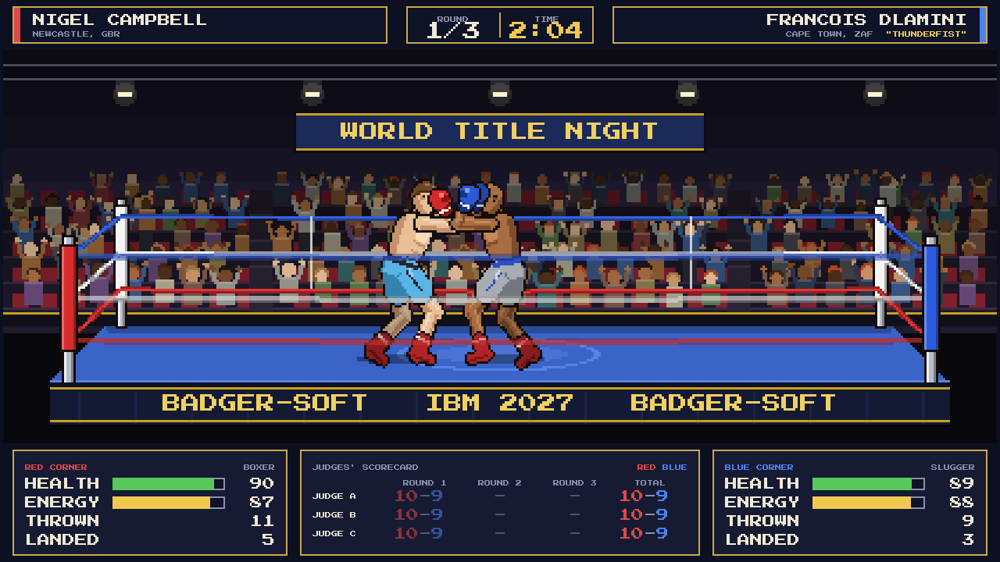

# International Boxing Manager 2027

*by Badger-soft*

An ode to *Barry McGuigan World Championship Boxing* (Commodore 64, 1985),
drawn in a 16-bit Amiga style but keeping the classic side-on view of the
ring. Built with **Godot 4.7** for PC and mobile.

This is the first build. It concentrates on the ring, the boxers and a fight
that plays itself out logically. There is no human trainer yet: both corners
are run by the AI.



---

## Running it

1. Install [Godot 4.7](https://godotengine.org/download) (the standard build;
   no C#/.NET needed).
2. Open Godot, choose **Import**, and select `project.godot` in this folder.
3. Press **F5** (Run Project).

Controls:

| Action                      | PC                   | Mobile        |
|-----------------------------|----------------------|---------------|
| Start / choose a button     | Mouse or Enter       | Tap           |
| Skip the tale of the tape   | Click, Space, Enter  | Tap           |
| Back to the main menu       | Esc                  | Back button   |

The project uses the **Compatibility** renderer so the same build runs on
desktop and on low-end phones. To make a phone build, install the Android
export templates from *Editor > Manage Export Templates* and add an Android
preset under *Project > Export*.

---

## What happens in a fight

* Two of the five randomly generated boxers are picked, and a venue is chosen
  at random.
* The **tale of the tape** compares them. Tap, or wait 12 seconds, to ring the
  bell.
* Three rounds. Each round is **1 minute of real time**, but the clock shows
  **3:00** and counts down at three times real speed.
* The **bell** rings to start each round, and three times to end it.
* Between rounds the boxers walk back to their corners. Each trainer picks
  one of four instructions (*attack more*, *defend more*, *keep it up*,
  *go all out*), and it appears in a speech bubble. It changes how the boxer
  fights the next round.
* Knockdowns get a count. A boxer may make it to one knee and then stand, or
  stay down. Three knockdowns in one round stops the fight.
* After three rounds the three judges' cards decide it: unanimous, majority
  or split decision, or a draw.

### How the boxers think

Every boxer has six skills from 1 to 99 and a fighting style.

| Skill        | What it does in a fight                                              |
|--------------|----------------------------------------------------------------------|
| Power        | Damage per punch                                                     |
| Speed        | How fast punches land, footwork, how often he gets to make a choice  |
| Stamina      | How slowly energy drains, so how slowly the other skills drop        |
| Chin         | How well big head shots are absorbed; how fast he beats the count    |
| Strength     | How little being hit drains energy and wears down the other skills   |
| Intelligence | Blocking, slipping, counter-punching, knowing when to back off       |

| Style    | Behaviour                                                                   |
|----------|-----------------------------------------------------------------------------|
| Brawler  | Plants himself at mid range and trades; rarely steps back                    |
| Slugger  | Walks forward to close range; hooks and uppercuts                            |
| Boxer    | Jab-led; throws, steps out, comes back in when it suits him                  |
| Counter  | Waits outside range and punishes misses; trades when he is on top            |
| Evasive  | Stays away and jabs, saving himself, then comes forward in the last round    |

As a boxer is hurt (low health or rocked by a head shot) he throws less, covers
up and backs off. When he is badly hurt and close, he holds on in a clinch.
Clever boxers do this sooner; reckless ones keep swinging. Punches do more
damage later in the fight and to tired boxers.

Each boxer starts with health a little below 100, set by his fitness (stamina,
strength and chin). A `recovery` stat is already stored for future builds,
where injuries will carry over between fights.

---

## Project layout

```
project.godot
data/
  world.json                  Regions, countries, cities, names, nicknames
assets/fonts/                 Press Start 2P pixel font (SIL Open Font License)
scenes/
  main_menu.tscn
  fight.tscn
  debug/                      Developer tools: pose sheet, venue preview
scripts/
  autoload/
    game_state.gd             Roster, next fight, command-line options
    sfx.gd                    Bell, punches and crowd, synthesised in code
  data/
    boxer_data.gd             A boxer's fixed details (Resource)
    boxer_generator.gd        Random boxers: hometown, name, body, skills
    palette.gd                Every colour in the game
  fight/
    fight_sim.gd              Clock, bell, punches, knockdowns, count, result
    fighter.gd                One boxer's live state during a fight
    boxer_ai.gd               Decision making for both corners
    judges.gd                 Three judges, 10-point must system
    punch_types.gd            The five punches and their numbers
  render/
    arena_view.gd             The low-res SubViewport holding ring + boxers
    arena_renderer.gd         Venues, crowd, ring, ropes, corner man
    venues.gd                 Venue colours and crowd layout
    boxer_rig.gd              Draws and animates a boxer
    boxer_skeleton.gd         Pose -> joint positions (two-bone IK)
    boxer_poses.gd            Pose and animation library
  ui/                         Theme, menus, name plates, score bug, scorecard...
tools/
  simulate_fights.gd          Headless balance checker
```

### How the boxers are drawn

There are no sprite sheets. One **procedural rig** is used for every boxer: a
pose is a few numbers (hip position, lean, glove and foot targets) and
`boxer_skeleton.gd` solves the elbows and knees with simple two-bone IK. The
body is then drawn from outlined, three-tone shaded shapes.

* **Height** (170-198 cm) scales the whole figure, at 0.45 px per cm.
* **Weight** (154-160 lb) and height together set the build: heavier boxers
  are wider and show more muscle definition, and taller boxers at the same
  weight look leaner.
* Skin, hair (and hair style), trunks, boots are colours. Gloves are always
  red or blue by corner, so the two boxers are easy to tell apart.

I chose this over separate sprite sets per height and weight because one set
of poses then works for every boxer, and new animations only need a few
numbers. Adding a pose means adding an entry to `POSE_DEFS` and an animation
to `ANIMS` in `boxer_poses.gd`.

The ring and boxers are drawn into a **424 x 168** SubViewport and scaled up x3
with nearest-neighbour filtering for the chunky pixel look. All UI text is
drawn at full resolution so it stays sharp on any screen.

### Animations included

Guard (gloves up), ready stance (arms at the stomach), relaxed stance, victory,
move forward, move back, jab, cross, uppercut, hook, body shot, drop to a knee,
knocked down (then up to a knee and back to the feet), bouncing off the ropes,
taunt with hands in the air while skipping, taunt with one hand raised. There
are also two hit reactions (head and body), a clinch and a dejected loser.

---

## Developer tools

All of these run from the project folder. `godot` is your Godot 4.7 executable.

```sh
# Run 200 fights with no graphics and print the balance summary
godot --headless --path . -s tools/simulate_fights.gd -- --fights=200

# Every pose and every skin/hair/size combination on one sheet
godot --path . scenes/debug/pose_sheet.tscn -- --capture=poses.png

# Screenshot a fight. --show can be intro, fight, break, count or result.
godot --path . scenes/fight.tscn -- --venue=2 --seed=21 --show=fight --capture=fight.png
```

Command-line options read by the game (after `--`):

| Option             | Meaning                                                   |
|--------------------|-----------------------------------------------------------|
| `--seed=<n>`       | Fixed random seed (same roster and fight every time)      |
| `--venue=<0-2>`    | 0 Small Town Gym, 1 City Gym, 2 Boxing Hall               |
| `--capture=<png>`  | Fast-forward, save a screenshot and quit                  |
| `--show=<moment>`  | What to capture: `menu`, `intro`, `fight`, `break`, `count`, `result` |
| `--at=<seconds>`   | Earliest real second of round 1 to capture (default 20)   |

### Code style

* Static typing everywhere, `##` doc comments on every class and public
  function.
* Tables of numbers are column-aligned so they can be read and tuned at a
  glance.
* UI sits on an 8 px grid with 16 px margins, using only the font sizes 8, 16,
  24, 32 and 48 (multiples of the pixel font's 8 px design grid). Numbers in
  tables are right-aligned, and scores always keep the dash in the same
  column.

---

## Credits

* Code and pixel art: Badger-soft
* Font: *Press Start 2P* by CodeMan38, SIL Open Font License 1.1
  (`assets/fonts/PressStart2P_OFL.txt`)
* Inspired by *Barry McGuigan World Championship Boxing* (Activision, 1985)
