# International Boxing Manager 2027

*by Badger-soft*

An ode to *Barry McGuigan World Championship Boxing* (Commodore 64, 1985),
drawn in a 16-bit Amiga style but keeping the classic side-on view of the
ring. Built with **Godot 4.7** for PC and mobile.

It started with the ring, the boxers and a fight that plays itself out
logically; both corners are run by the AI. Around that there is now a whole
world of rankings, titles and a monthly season, and a **career**: create a
boxer and manage him from the bottom of the amateurs.

The main menu has three buttons:

* **EXHIBITION** - pick any two boxers (or let the computer pick with
  RANDOM) for a one-off 3-round fight. It counts for nothing: no record,
  no purse, no change in the rankings.
* **CAREER** - start a new career, or continue a saved one (only offered
  when there is one). See *The career*.
* **BOXERS** - everyone in the three divisions, and their profiles.


---

## Running it

1. Install [Godot 4.7](https://godotengine.org/download) (the standard build;
   no C#/.NET needed).
2. Open Godot, choose **Import**, and select `project.godot` in this folder.
3. Press **F5** (Run Project).

Controls:

| Action                      | PC                   | Mobile        |
|-----------------------------|----------------------|---------------|
| Start / choose a button     | Mouse or Enter       | Tap           |
| Skip the tale of the tape   | Click, Space, Enter  | Tap           |
| Skip the judges' read-out   | Click, Space, Enter  | Tap           |
| Back (or pause a fight)     | Esc                  | Back button   |
| Shout ATTACK / DEFEND / KO  | A / D / K            | Shout buttons |

In the ring, the tale of the tape has BACK and FIGHT! buttons: BACK (or
Esc) leaves before a punch is thrown and nothing is recorded. Once the
fight is on, Esc pauses it: RESUME, SKIP TO RESULT (the rest is fought at
once and the verdict follows), and QUIT FIGHT for a fight that counts for
nothing. A season fight can't be quit once it has started, so it can't be
abandoned and watched again for a different result.

The project uses the **Compatibility** renderer so the same build runs on
desktop and on low-end phones. To make a phone build, install the Android
export templates from *Editor > Manage Export Templates* and add an Android
preset under *Project > Export*.

---

## What happens in a fight

* A fight opened on its own (the fight scene run from the editor or the
  command line) picks a weight division and a boxer at random, and an
  opponent ranked near him (no more than 4 places above or 6 below). The fight's
  length, purse and venue (Small Town Gym, City Gym, Boxing Hall or Grand
  Arena) suit the better man's level, and a fight involving the champion is
  for his IBC title, at the Grand Arena (see *Rankings, titles and money*).
* The **tale of the tape** compares them. Tap, or wait 12 seconds, to ring the
  bell.
* Fights come in four lengths: **3 rounds** (exhibition), **6** (amateur),
  **10** (semi-pro) and **12** (professional, and every title fight). The
  boxers' level decides it; `--rounds=<n>` picks another length for
  testing. Each round is
  **1 minute of real time**, but the clock shows
  **3:00** and counts down at three times real speed.
* The **bell** rings once (a short, soft ring) to start each round, and
  three times to end it. At the bell both boxers walk briskly out of their
  corners and meet in the middle in about 3 seconds; only a really
  defensive boxer (an evasive one, one told to defend, or one still badly
  hurt) takes his time.
* Between rounds the boxers walk back to their corners. Each trainer (off
  screen by the corner post) picks one of four instructions (*attack more*,
  *defend more*, *keep it up*, *go all out*), and it appears in a speech
  bubble pointing down to the corner. It changes how the boxer fights the
  next round. Once a boxer sits down, his health and energy bars climb to
  where his corner can get him (quickly at first, then easing), so you can
  watch how far each man comes back. Good stamina and recovery bring him
  back further, and the corner does less as the fight goes on (by the last
  break, 70% of what it could do early on).
* Punches can land clean, be slipped, or be **blocked**. A boxer who covers
  up blocks most head shots (and catches some body shots on his elbows);
  how well depends on his intelligence and speed against the puncher's
  intelligence.
* Hard, clean power shots that really hurt count as **significant strikes**
  (about one landed punch in five). The panels under the ring show each
  boxer's punches thrown, landed and significant strikes. Some
  judges weight a significant strike well above an ordinary landed punch;
  others just count it as another punch landed.
* Skilled boxers (quick hands and a good head) throw the **one-two**, a jab
  followed straight away by a cross, and a counter-puncher loves to fire one
  back the moment he has slipped or blocked a punch. When the jab lands
  clean the cross catches the other man still reeling: it does 25% more
  damage and is a little likelier to be a big punch. A landed one-two shows
  "ONE-TWO!" over the boxer and gets a roar from the crowd (about three per
  boxer in a six-round fight).

  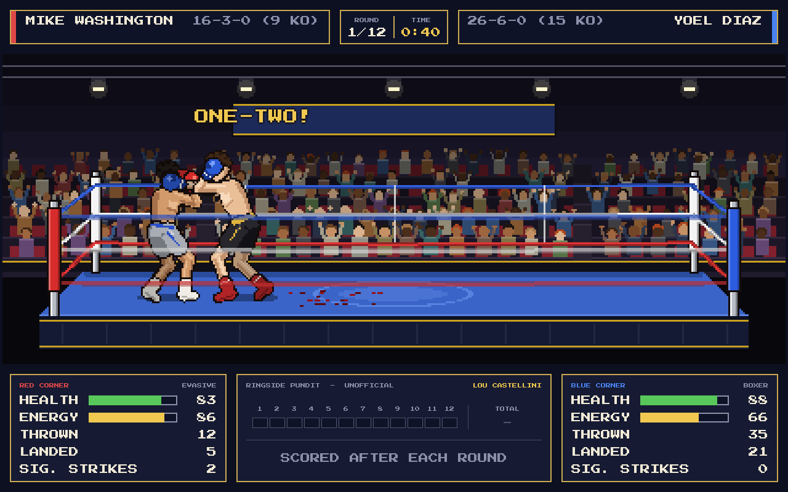

* Now and then a **big punch** lands: far more damage, twice the chance of a
  knockdown, blood spraying off where it lands (it leaves spots on the
  canvas for the rest of the fight), a heavy thud and the crowd roaring in
  anticipation. They are rare (about one every two rounds per boxer) and come
  from a run of clean punches, an opponent running out of gas, a dropped
  guard (hurt, showboating or hands down) or a good counter; harder
  punchers and smarter boxers make more of them.
* **The crowd** cheers for the big moments and keeps cheering for a while
  before it dies away: a little for a significant strike or a one-two,
  more for a big punch, and longest for a knockdown (right through the
  count) and for the winner's name.
* Knockdowns get a count. A boxer may make it to one knee and then stand, or
  stay down. Three knockdowns in one round stops the fight.
* When the fight ends, both boxers and the referee turn to face the crowd in
  the middle of the ring, the referee holding each man by the wrist. A slim
  two-line band over the crowd does the announcing, so nothing covers them:
  after the last round the judges' cards are read **one at a time**, like a
  ring announcer ("Judge H. Pemberton scores the bout..." then "58-56 in
  favour of Johnson"), and each judge's row fills in on the official
  scorecards, which take over the whole bottom of the screen. The crowd gives a small cheer for
  a score that looks fair and an "oooh" for one that doesn't (judged against
  a neutral card of the fight). Then the winner: by unanimous
  (3-0), split (2-1) or majority (2-0 with one even) decision, or a
  unanimous, majority or split draw. As the name is called the referee
  **lifts the winner's arm** (both arms for a draw) and the loser drops his
  head. A stoppage goes straight to "And the winner, by knockout in round 2
  at 1:47...". CONTINUE then appears on the ring apron.
* CONTINUE opens the **fight stats**. Both boxers' numbers sit side by
  side, with the better one in gold: punches thrown and landed, accuracy,
  jabs and power punches, significant strikes, big punches, one-twos,
  punches avoided, knockdowns and health at the end. Under them are the
  result (winner, method, purse and how each man moved in the rankings)
  and the **match rating** out of 10 (see *Excitement ratings*). NEW FIGHT
  (or FIXTURES for a season fight) and MAIN MENU are at the bottom.

  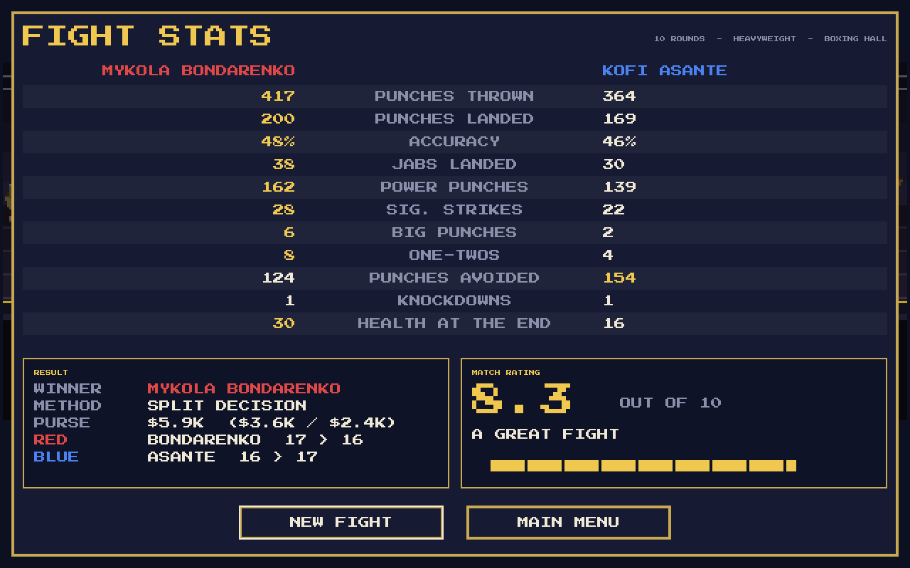
* The ring aprons and the hall's back banner are left plain for now.


### Judges and the ringside pundit

Three judges are drawn for each fight from a pool of 15 in
`data/officials.json`. Before the first bell the panel under the ring shows
**today's judges**, with where each is from and their public **fairness**
band: FAIR, SO-SO or WILD (the number behind it is never shown). Most of the
pool is fair; a few are not.

Each judge also has SECRET preferences that are never shown in game: how much
they value attacking, defence, punches landed, punches thrown, power and
significant strikes. On
top of that, fairness controls how far a judge strays from what they saw:
round-to-round personal opinion, and a lean towards one boxer that is strongest
when a boxer comes from the judge's own country.

The official cards are **secret until the final bell**. During the fight the
panel shows a **TV pundit's unofficial card** instead. Five pundits share the
job, each with a secret accuracy rating: they score like a neutral judge with
a little error, so the card is a good guide with the occasional bad call.
Like a real card it is only filled in when the bell ends each round. Each
round is a box coloured by who won it (red, blue, grey for even, with a gold
edge for a 10-8 round), with the round numbers above and the running total
beside them; the boxes are sized so 3, 6, 10 and 12 rounds all fit. The
official cards use the same boxes, one row per judge, and take over the
bottom of the screen when the verdict is read, one judge at a time, with a
pause before each score and before the winner's name.

Knockdown rounds are scored the way real judges do it: the boxer who scored the
knockdown wins the round, 10-8 if he was clearly winning it anyway, otherwise
10-9, with a point for every extra knockdown.

Over 1,000 simulated fights (`tools/simulate_fights.gd`) the three cards were
identical in about a third of decisions, the judges split on about a third of
all rounds, about 1 decision in 9 differed from a neutral card and about 1 in
20 gave the fight to the wrong boxer outright. Pundits matched a neutral card
88-94% of the time depending on their accuracy, and draws were about 7% of
all fights.

### How the boxers think

Every boxer has six skills from 1 to 99 and a fighting style.

| Skill        | What it does in a fight                                              |
|--------------|----------------------------------------------------------------------|
| Power        | Damage per punch; more big punches                                   |
| Speed        | How fast punches land, footwork, blocking, how often he gets to act  |
| Stamina      | How slowly energy drains, so how slowly the other skills drop        |
| Chin         | How well big head shots are absorbed; how fast he beats the count    |
| Strength     | How little being hit drains energy and wears down the other skills   |
| Intelligence | Blocking, slipping, counter-punching, knowing when to back off       |

| Style    | Behaviour                                                                            |
|----------|--------------------------------------------------------------------------------------|
| Brawler  | Plants himself at mid range and trades; rarely steps back                            |
| Slugger  | Walks forward to close range; hooks and uppercuts                                    |
| Boxer    | Jab-led; throws, steps out, comes back in when it suits him                          |
| Counter  | Waits outside range and punishes misses; trades when he is on top                    |
| Evasive  | Stays away and jabs, saving himself, then comes forward in the last round            |
| Showboat | Quick reactions and slips punches, but drops his guard and taunts; can be caught out |

Nobody can win by hiding: a boxer who has not thrown for a couple of seconds
edges closer, so two cautious styles (a counter-puncher and an evasive boxer,
say) still end up exchanging.

As a boxer is hurt (low health or rocked by a head shot) he throws less, covers
up and backs off. When he is badly hurt and close, he holds on in a clinch.
Clever boxers do this sooner; reckless ones keep swinging. Punches do more
damage later in the fight (up to 12% more by the last round) and to tired
boxers.

Each boxer starts with health a little below 100, set by his fitness (stamina,
strength and chin). In the corner between rounds he gets back some of his
breath (more with good stamina) and shakes off 12-28% of the damage he has
taken, depending on his **recovery** stat (shown on his profile); less as
the fight goes on.

### Weight divisions and the roster

There are three divisions, thirty boxers in each. Every fight is between two
boxers from the same division.

| Division     | Height       | Weight       | In the ring                                         |
|--------------|--------------|--------------|-----------------------------------------------------|
| Lightweight  | 165 - 178 cm | 130 - 136 lb | Quicker, punches a little lighter, fewer knockouts  |
| Middleweight | 170 - 198 cm | 154 - 160 lb | The baseline                                        |
| Heavyweight  | 185 - 204 cm | 200 - 290 lb | Slower, hits much harder, far more knockouts        |

Each division's roster is the same every run (seeds 1983, 1985 and 2025 in
`scripts/data/divisions.gd`; pass `--roster=<n>` for a different set).
Heavyweights have no upper limit in real life, and most are well-toned men
rather than big ones: weights are skewed towards the light end of the range
(in the default roster most weigh under 245 lb), with a few
big men near 290 lb. The heaviest are drawn heavy rather than obese.

Showboats are rarer than the other styles: two or three per division. They
show off at two levels: now and then during a fight they point a glove at
the other man or drop their hands and stick out the chin; in the second half
of a fight, when they are on top, they throw both arms in the air. Half the
time they do the same over a man they have just knocked down.

**BOXERS** on the main menu has a tab per division listing its boxers ten to
a page, best first by overall rating or, with the ORDER button, in ranking
order: the arrows beside the tabs (or Page Up / Page Down) turn the pages.
Each row shows the boxer's ranking (C for the champion, whose IBC belt
follows his name), country, age, record (W, L, D and KO, each centred
under its heading), style (BRL, SLG, BOX, CNR, EVA or SHW), weight, level
(AM, SEMI or PRO) and overall rating, with any nickname under the name.
Choose a boxer to open his **profile**: a portrait, his details, his career
(ranking, level, earnings and manager) and all six skills as bars, with
PREV and NEXT to step through the division in the same order.

**Monsters and glass jaws.** In every division two of the best men are
**monsters**: knockout artists with huge power, a granite chin and
records with 90-100% of their wins inside the distance ("KNOCKOUT ARTIST"
on the profile). They come forward looking for the finish, hit harder, land
more big punches and knock men down more often, and when you watch them
they dominate. One more is a **glass jaw**: he looks just like a monster on
paper and punches like one (power, record and all), but his chin is poor. A significant punch
landing clean on his chin is more than twice as likely to put him down, and
he is slower to get up, so the right shot COULD knock him out.

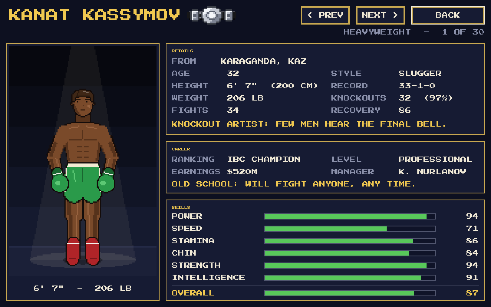

Fights get more dangerous the shorter they are: knockdowns and damage are
scaled by fight length, so a 12-round fight is not twice as likely to end
early as a 6-rounder. Over 100 simulated fights each, stoppages ended about
31% of middleweight fights over 6 rounds and 33% over 12, and 52% and 42%
of heavyweight fights; lightweights stop least.


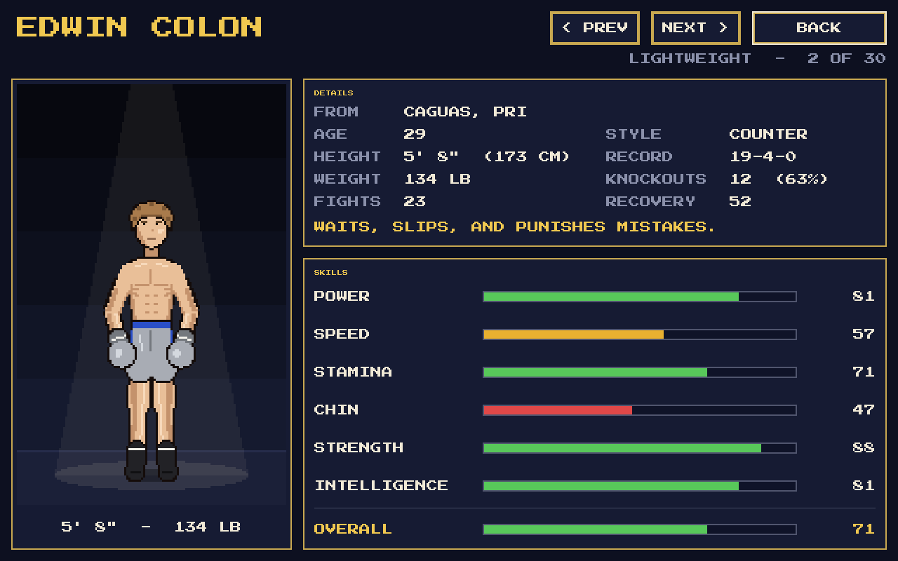

### Rankings, titles and money

Every division is ranked from top to bottom. Each has one title, the **IBC**
title, held to begin with by its best man. The champion is listed first as
**C** with the belt (a black strap with silver stitching, a big oval silver
centre plate engraved with a ring and a star, and a smaller riveted silver
plate either side) next to his name: in the Boxers list, on his profile, on
his name plate in the ring and in the tale of the tape. The other boxers are
numbered contenders, and the order is split into thirds, which are the
boxers' **levels**:

| Level        | Who                       | Fight length | Purse                               |
|--------------|---------------------------|--------------|-------------------------------------|
| Professional | Top third (C and 1 - 9)   | 12 rounds    | $5M - $100M (tens of millions)      |
| Semi-Pro     | Middle third (10 - 19)    | 10 rounds    | $5K - $50K (mostly $5K - $25K)      |
| Amateur      | Bottom third (20 - 29)    | 6 rounds     | $1.2K - $5K (mostly $1.5K - $3K)    |

A fight's level, length and purse come from the better-ranked man. Within a
level the purse grows with how high the two men are ranked between them,
then it is cut to 70% if no title is on the line and scaled by division
(heavyweight 100%, middleweight 80%, lightweight 60%). So the most junior
fight, two lightweights at the bottom, pays about $500, and only a
heavyweight title fight between the champion and the number 1 reaches
$100M. The winner takes 60% and the loser 40% (half each for a draw), and
it goes on their **career earnings**. The starting boxers already have
earnings that fit their ranking and career: a top-ten heavyweight with
twenty or thirty fights has made a few hundred million dollars, a young
amateur a few thousand.

A title fight is announced with the winner as "...AND STILL IBC HEAVYWEIGHT
CHAMPION" when the champion keeps his belt, or "...AND NEW IBC HEAVYWEIGHT
CHAMPION" when it changes hands. A drawn title fight leaves the champion
with his belt.

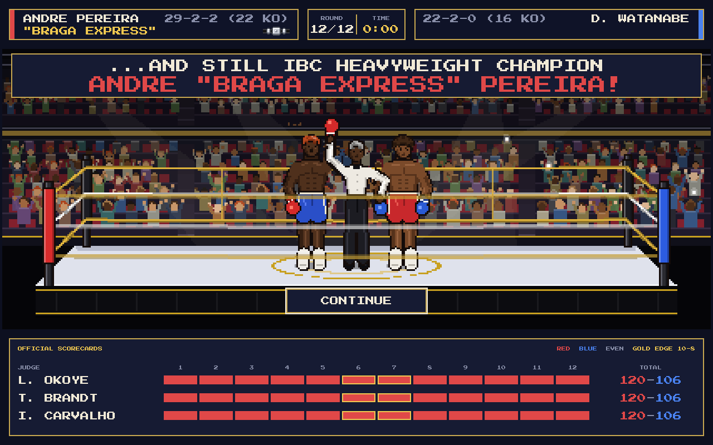

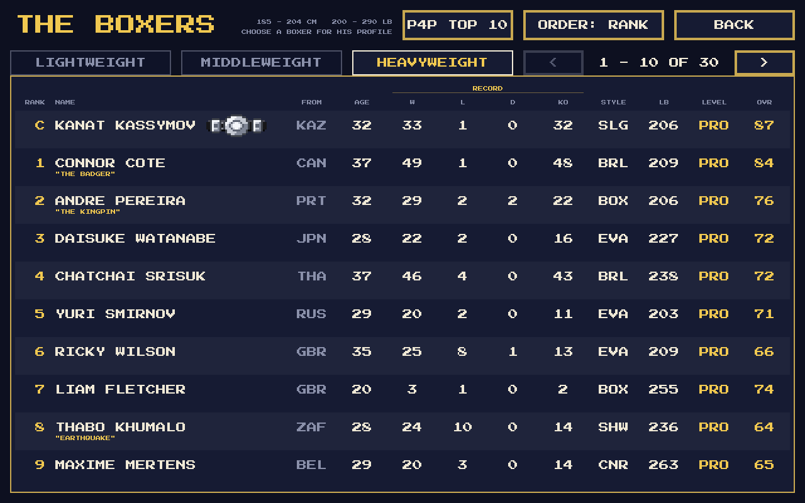

Every boxer has his own **manager**, and each manager is one of three types
(shown on the boxer's profile): a *Money Man* chases the biggest purse
going, a *Protective* manager looks for easier fights for his man, and an
*Old School* manager will take on anyone. They arrange the season's fights
(see *The season*).

**How results move the rankings.** There are two systems, picked with
`--ranking=ladder` (the default) or `--ranking=points`:

* **Ladder.** If the winner was ranked below the loser, he takes the loser's
  place and the loser, and everyone between them, drops one place. A win
  over a lower-ranked man, or a draw, changes nothing. Easy to follow: a big
  win is a big jump, and a loss only ever costs one place.
* **Points.** Every boxer has ranking points and the order is simply who has
  most (each place starts 20 points apart). A win earns up to 40 points,
  more the bigger the upset (Elo-style, where a 200-point gap makes the
  better man a 10-to-1 favourite), with a bonus for a win inside the
  distance or in a title fight. A loss costs only half what the same win
  would have earned. Boxers climb steadily, an upset is rewarded, and one
  bad night costs a place or so rather than a career. Beating the man four
  places above you is worth about a place and a half; losing to someone
  six places below you costs about one.

Either way the champion keeps the top spot until he loses his title: a
champion beaten in a non-title fight keeps his belt, and the man who beat
him moves up as if he had beaten the number 1.

### Pound for pound

**P4P TOP 10** on the Boxers screen lists the ten best boxers in the IBC,
whatever their weight. Each man's score (PoundForPound) has two parts:

* **His record**: 40 x (wins + half his knockouts) / (fights + 3), scaled
  by where he stands in his division now - from 40% at the bottom to 100%
  for the champion, so a record built among the best counts for more than
  one built among the amateurs.
* **This season's fights**, each against an opponent of known quality
  (1 for the champion down to 0 for the bottom man, where he was ranked
  when they fought): a win is worth 4 + 12 x quality squared (x 1.3 by
  knockout), a draw 4 x quality, and a loss costs 8 - 6 x quality - losing
  to a top man costs little, losing to a nobody a lot.

So wins and knockouts count, and the higher the man he beat was ranked,
the more they count. The list shows each man's division and ranking, his
record and knockouts, his best win this season (and where that man was
ranked, and how he won) and his score; the player's boxer is in gold if he
makes it.

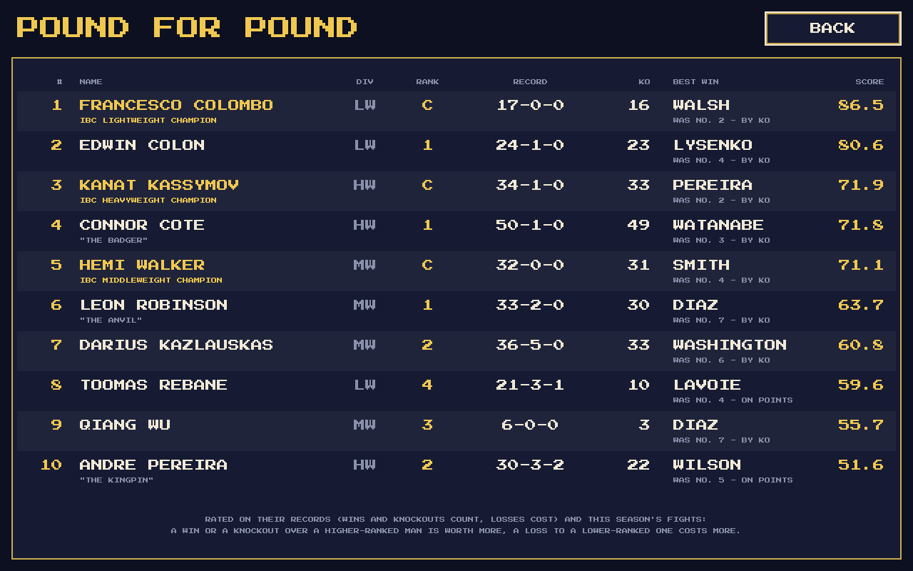

### The season

In a career, **FIXTURES** on the career page opens the season's fixtures.
The season starts in January 2027 and runs a month at a time:

* **Arranging fights.** At the start of each month the managers arrange
  fights for two months on: that is the boxer's **training camp**, during
  which he trains 50% harder (more improvement in his skills). A boxer can
  have a new fight arranged a month after his last one, and must have one
  arranged by two months after it. So fights are three or four months
  apart, everyone fights three or four times a year, and about a quarter
  of all the boxers fight in any month. A boxer can only be matched with
  someone who isn't already booked and is past that month's recovery.
* **Who can fight whom.** In his own division, someone no more than 4
  places above him or 6 below. In the division above, only its bottom two
  available men. In the division below, only its top three available men.
  Managers look outside their division only now and then.
* **Who the manager picks.** A *Money Man* takes the biggest purse on
  offer, a *Protective* manager the weakest man on offer (and turns down
  challengers clearly better than his own boxer), and an *Old School*
  manager anyone at all.
* **Titles.** A champion's fights are often for his title, and any fight
  nine months or more after his last defence must be, so he defends at
  least once a year. If a champion retires the title is vacant, and the
  two best contenders fight for it as soon as both are free (until then
  neither takes another fight).
* **Fight night** is the end of the month. The **Fixtures** screen lists
  the month's fights (division, each man's ranking and record, rounds and
  purse, with the belt for a title fight). Choose one to **watch** it in
  the ring, or **PLAY MONTH** to have the rest fought. Every fight is a
  full FightSim fight, exactly as a watched one runs, simulated on a
  worker thread so the screen keeps moving as each result comes in. BOOKED
  shows the fights arranged for the months after, and LAST MONTH the
  previous results.
* **Month end.** Everyone trains (harder in camp) and gets older. Young men
  still improve, men in their prime hold steady, and from 32 skills start
  to fade, speed first. Men over 34 may retire (at 39 they always do), and
  a young prospect takes each one's place at the bottom of his division.
  Then **READ THE PAPER**.

**The newspaper**, THE RINGSIDE GAZETTE, comes out every month. Its main
headline is a title fight, a new champion first and then a successful
defence (any other title fights get stories underneath). A professional
fight rated 9 or more out of 10, with a top-ten man (or the champion) in
it, gets a feature raving about it. With neither, the month's biggest upset
or best fight leads. A round-up of the other results follows, and IN BRIEF
notes everyone who climbed the rankings in the player's division (the
middleweights, until there is a player's boxer), plus retirements and new
faces. RESULTS lists every fight of the month with its rating, and keeps
the kind of result under each one for the record (UD, SD or MD under
POINTS, UNANIMOUS / MAJORITY / SPLIT under DRAW, 3 KNOCKDOWNS under a TKO);
the Fixtures screen's LAST MONTH shows the same.

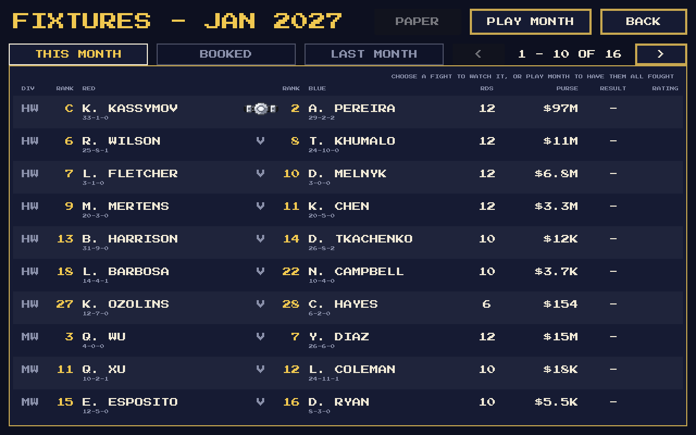

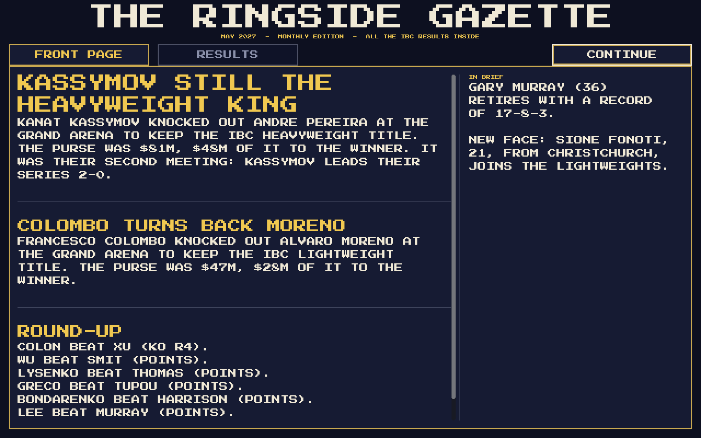

### The career

**CAREER > START NEW CAREER** opens the **new boxer** screen. He starts
with a random look, name and hometown, all of which can be changed:

* NAME and SURNAME, typed in.
* SKIN, HAIR colour, HAIRCUT, and the colours of his TRUNKS, GLOVES and
  BOOTS, each with < and >. His gloves are his own: in the ring he wears
  them whichever corner he is in (the computer's boxers wear their
  corner's red or blue).
* Under his portrait: DIVISION (Lightweight to start with) and STYLE (the
  standard types).
* NICKNAME: ten made up for him, or NO NICKNAME.
* FROM: a country, then one of its cities.
* SKILLS: every skill starts at 35, except by division - a lightweight
  starts with speed 45, a middleweight with speed 40 and power 40, a
  heavyweight with power 45. There are **45 points** to spend between them
  using - and + (from 10 to 65 each); points taken off a skill go back in
  the pool, and points spent stay with him if he changes division.

START CAREER builds a fresh world (the starting rosters and a new season)
with him at the bottom of his division, at 20, 0-0-0, with **$5,000** in
the bank. The career is saved straight away, at the end of every month and
when leaving for the main menu (SAVE saves it any time). Saves live in
`user://careers/`; **CONTINUE SAVED CAREER** lists them, newest first.

**The career page** shows the boxer and his overall rating, ranking,
level, record, health, money, earnings, sponsor and the week's rent, his
next fight, the men offering him a fight, and the latest news. Time moves
a **week** at a time (NEXT WEEK), four weeks to a month:

* **Training**: once a week choose WEIGHTS (strength, some chin), SPEED
  (speed, some ring sense), STAMINA (stamina, some recovery), PUNCHING
  (power, some technique) or RECOVERY (no skills, but half as much again
  as a normal week's health comes back on top, more at a better recovery
  centre; greyed out while he is fully fit). The others are greyed out
  until next week. How much he gains
  depends on the gym, and less as a skill gets higher. The training
  buttons are tinted blue so they stand apart from the menu.
* **NEXT WEEK** pays the week's rent and lets him recover a little. In the
  last week of the month it reads **FIGHT NIGHT** and opens the fixtures.
  The month's fights can only be fought on fight night. If he is on the
  card his fight comes first and is always fought in the ring (YOUR
  FIGHT); then PLAY MONTH has the rest fought (any can be watched first).
  The moment the last fight is done the month ends - purses banked,
  sponsor's months counted down, new offers, the paper written - whether
  or not he reads it (READ THE PAPER); the career moves on to week 1.
* **In his corner**: in his own fights the player is his trainer.
  Between rounds he gives the orders for the next round (the bell waits
  for them): HANDS UP, STAY SAFE (cover up, avoid getting hit), STICK TO
  THE PLAN, TURN UP THE HEAT (press forward, throw more) or TAKE HIM OUT
  (go all out for the knockout). Once a round, for 15 seconds, he can
  shout (buttons along the bottom of the ring, or A / D / K): ATTACK!
  (about half as many punches again), DEFEND! (a third fewer, more
  guarding and slipping, harder to catch) or KNOCK HIM OUT! (he throws as
  much as ATTACK! and loads up the power punches: about three times as
  many big punches - and about three times as many big counters come back
  at him).

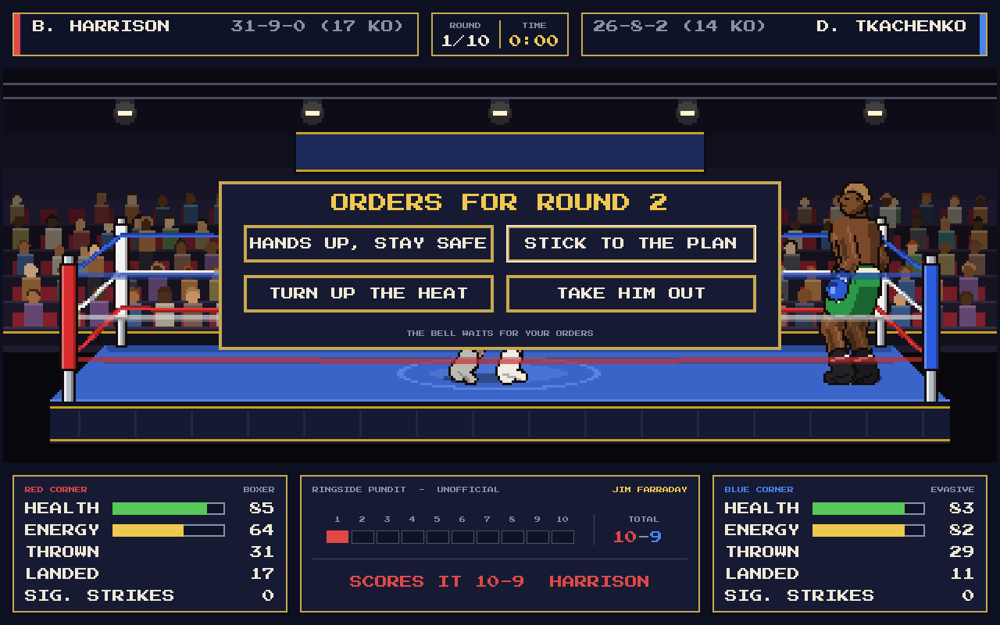

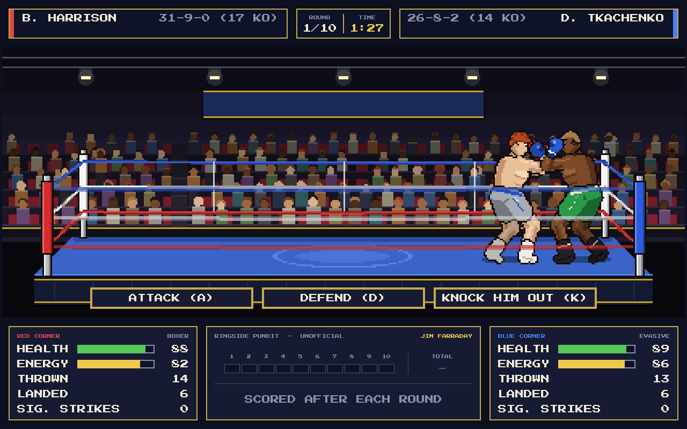

* **Health**: he comes out of a fight with the health he ended it with
  (FIT, BRUISED, HURT, INJURED) and gets it back week by week. A boxer who
  isn't fully fit starts his next fight with less health.

**FACILITIES** has three tabs:

* **TRAINING** - Local Gym (free, x1.0), Boxing Club ($400 a week, x1.3),
  Fight Academy ($2.5K, x1.7), Performance Centre ($12K, x2.2) and
  Olympic Complex ($50K, x3.0). BOOST multiplies every training session.
* **RECOVERY** - Local Day Spa (free), Physio Clinic ($300), Sports
  Injury Clinic ($2K), Private Hospital ($9K) and Elite Medical Institute
  ($40K): how quickly he gets his health back between fights.
* **SPONSORS** - each month a few firms may offer a one-off payment for 3,
  6 or 12 months. An unknown amateur gets few offers, all from small local
  firms; the higher he is ranked (and the better his record) the more
  offers come, from regional, national and finally global names, and for
  much more. There is no catch, but he can have only one sponsor at a
  time.

Rent is paid at the end of each week; a facility can only be chosen if he
can pay for its first week.

**SCHEDULE** arranges his fights:

* The men he may fight are those in his division no more than 4 places
  above him or 6 below, who are free (no fight arranged, recovered from
  their last), plus anyone who has asked to fight him (OFFERING A FIGHT).
  Only a few managers ask in a month, and only now and then do they pick
  an unknown like him.
* Choose a man to offer him a purse: five choices from LOW (60% of the
  usual purse) through USUAL to HIGH (150%). He must have half the purse
  in the bank to offer it. A man who wants the fight nearly always says
  yes; an unsure one is swayed by money, and may turn down a low offer
  (then he is marked TURNED YOU DOWN for the rest of the week).
* One fight at a time, two months on, like everyone else's. Once it is
  arranged the list is greyed out and **CANCEL FIGHT** calls it off, for a
  forfeit of a quarter of the purse.
* A fight between the top two men for a vacant title is for the title.
* **Head to head**: the VS YOU column shows his record against each man
  (his wins first: 2-0, or 1-1-1 with a draw), "-" if they have never met;
  gold if he leads. The purse offer says it too: FIRST MEETING, YOU LEAD
  2-0, HE LEADS 1-0 or ALL SQUARE AT 1-1.

Head to heads count every fight in the season between the two men (not
exhibitions). The **tale of the tape** has a HEAD TO HEAD row with each
man's wins (FIRST MEETING if they have never fought), and the **newspaper**
says when a fight was a rematch ("IT WAS THEIR SECOND MEETING: MURRAY
LEADS THEIR SERIES 2-0."). The round-up gives each fight one line, how it
ended included ("COLON BEAT LYSENKO (KO R2), LEADS 2-0."; any decision is
just "(POINTS)"), and the
player's own fight always heads it.

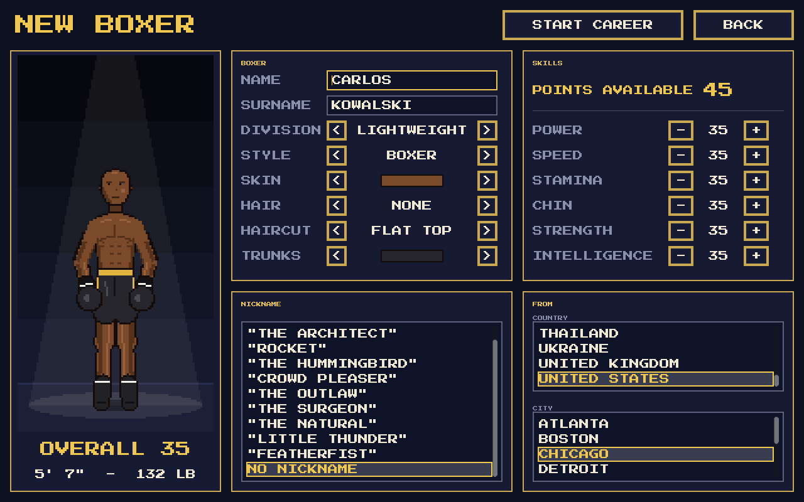

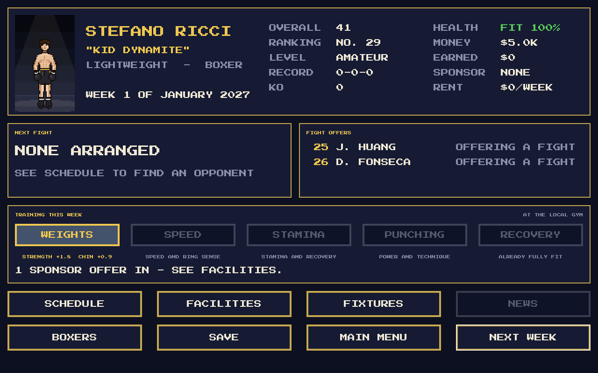

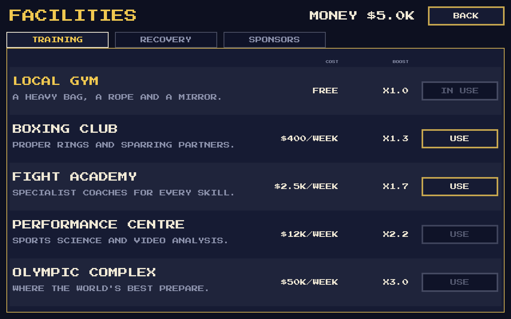

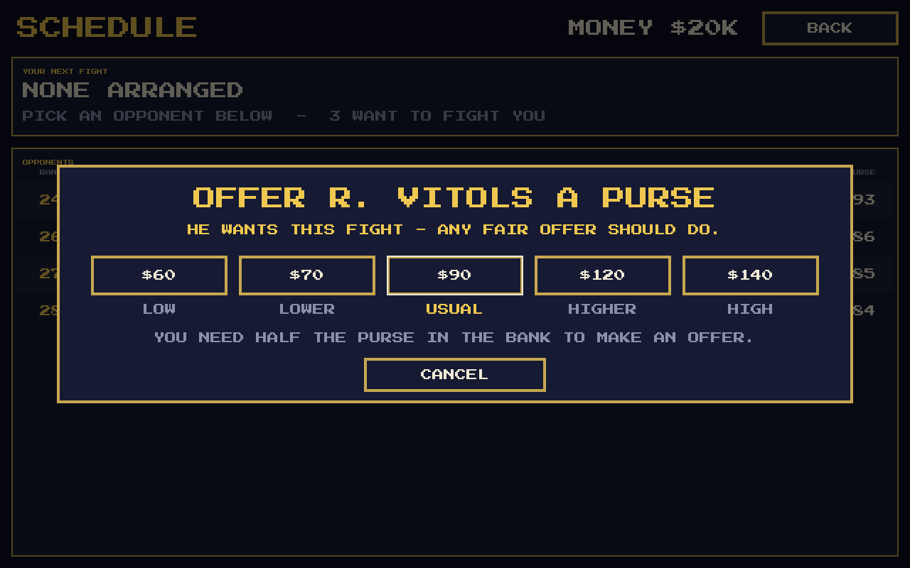

### Excitement ratings

Every fight, watched or simulated, is rated out of 10 for excitement from
what happened in it. Points come from knockdowns (more if both men went
down), a comeback (the winner was knocked down, or behind on a neutral
card from halfway on), big punches, one-twos, the work rate, a close or
split decision or a draw, a knockout (more for a late one) and a title on
the line. The total is put on an S-shaped curve: most fights land between
3 and 7, a great one 8 or more, and 9 or more is rare (about 5 in every 100
fights in a simulated year). 10 is next to impossible.

### Records (placeholders for now)

Every boxer has an age (20-37) and a made-up professional record, shown as
wins-losses-draws with knockouts, e.g. `22-3-1 (14 KO)`:

* Older boxers have had more fights (about 1.5-3.5 a year since turning pro),
  never more than 50.
* Better all-round boxers win a bigger share; draws are rare.
* Harder punchers finish more of their wins by knockout.

Records appear on the name plates and in the tale of the tape, and are
updated after every fight for the rest of the session.

### Nicknames

Between 40% and 50% of each division has a nickname, and no two boxers in
the game share one. About half come from a pool that suits the boxer's style
(a Counter puncher might be "The Mongoose", an Evasive boxer "Zigzag"), about
a third from one that suits his division ("Pocket Rocket" at lightweight,
"The Juggernaut" at heavyweight), and the rest from a general pool that
includes hometown names such as "The Kumasi Kid". There are 130 in
`data/world.json`, none longer than 18 characters so they always fit at full
size, and well-known real boxers' nicknames are left out.

---

## Project layout

```
project.godot
data/
  world.json                  Regions, countries, cities, names, nicknames
  officials.json              Judges (fairness, secret likes) and TV pundits
  sponsors.json               Made-up sponsors, local firms to global brands
assets/fonts/                 Press Start 2P pixel font (SIL Open Font License)
scenes/
  main_menu.tscn              EXHIBITION, CAREER and BOXERS
  p4p.tscn                    The pound-for-pound top ten
  new_boxer.tscn              Creating the career's boxer
  career_home.tscn            The career page: the boxer, training, menus
  facilities.tscn             Gyms, recovery and sponsors
  schedule.tscn               Arranging the boxer's fights
  fight.tscn
  roster.tscn                 The Boxers screen (one table per division)
  fixtures.tscn               The season's fixtures, results and PLAY MONTH
  newspaper.tscn              The monthly newspaper
  profile.tscn                One boxer's profile: portrait, details, skills
  debug/                      Developer tools: pose sheet, venue preview
scripts/
  autoload/
    game_state.gd             Rankings, next fight, recording results, options
    sfx.gd                    Bell, punches and crowd, synthesised in code
  data/
    boxer_data.gd             A boxer's fixed details (Resource)
    boxer_generator.gd        Random boxers (hometown, name, body, skills) and managers
    manager_data.gd           A boxer's manager and his type
    palette.gd                Every colour in the game
    fight_lengths.gd          3 / 6 / 10 / 12 rounds and their level names
  world/
    rankings.gd               A division's ranking order, champion and levels
    purse.gd                  What a fight is worth, and money as text
    career.gd                 Starting career earnings
    season.gd                 The calendar: fixtures, results, month end
    matchmaker.gd             Managers arranging fights (the challenge rules)
    fixture.gd                One arranged fight and its result
    training.gd               A month of training and getting older
    excitement.gd             Rating a fight out of 10
    newspaper.gd              Writing the monthly paper
    player_career.gd          The player's boxer: money, weeks, fights, sponsors
    facilities.gd             Gyms and recovery centres, training sessions
    career_save.gd            A saved career (Resource, in user://careers)
    pound_for_pound.gd        Rating the best boxers across the divisions
  fight/
    fight_sim.gd              Clock, bell, punches, knockdowns, count, result
    fighter.gd                One boxer's live state during a fight
    boxer_ai.gd               Decision making for both corners
    judges.gd                 Three judges + pundit card, 10-point must system
    officials.gd              Loads the judge/pundit pool and picks a panel
    punch_types.gd            The five punches and their numbers
  render/
    arena_view.gd             The low-res SubViewport holding ring + boxers
    arena_renderer.gd         Venues, crowd, ring, ropes, advice bubbles
    venues.gd                 Venue colours and crowd layout
    boxer_rig.gd              Draws and animates a boxer (side-on)
    front_rig.gd              A boxer or the referee seen face-on
    ceremony.gd               Boxers and referee waiting for the verdict
    portrait_backdrop.gd      The studio backdrop behind a profile portrait
    boxer_skeleton.gd         Pose -> joint positions (two-bone IK)
    boxer_poses.gd            Pose and animation library
  ui/                         Theme, menus, name plates, belt icon, scorecard...
tools/
  simulate_fights.gd          Headless balance checker
```

### How the boxers are drawn

There are no sprite sheets. One **procedural rig** is used for every boxer: a
pose is a few numbers (hip position, lean, glove and foot targets) and
`boxer_skeleton.gd` solves the elbows and knees with simple two-bone IK. The
body is then drawn from outlined, three-tone shaded shapes.

* **Height** scales the whole figure, at 0.45 px per cm.
* **Weight per centimetre of height** sets the build (`BoxerSkeleton.build_for`):
  torso width, limb and neck thickness. Lightweights are drawn with a slimmer,
  wiry frame and visible ribs; heavyweights are broad and thick-limbed, and the
  heaviest carry a belly and love handles, with the waistband wrapping round.
  Taller boxers at the same weight look rangier.
* Skin, hair (and hair style), trunks, boots are colours. Gloves are always
  red or blue by corner, so the two boxers are easy to tell apart.
* Seen **face-on** (his profile portrait and the verdict) a boxer is drawn by
  `front_rig.gd` from the same proportions, build and colours, so he is
  recognisably the same man; the build is toned down a little because a big
  man looks less wide from the front than from the side. The referee uses
  the same rig in a white shirt, bow tie and black trousers, and the
  ceremony solves both men's arms with the same IK so his hand stays on the
  boxer's wrist (or forearm, for a tall heavyweight) as he lifts it.

I chose this over separate sprite sets per height and weight because one set
of poses then works for every boxer, and new animations only need a few
numbers. Adding a pose means adding an entry to `POSE_DEFS` and an animation
to `ANIMS` in `boxer_poses.gd`.

The ring and boxers are drawn into a **424 x 168** SubViewport and scaled up x3
with nearest-neighbour filtering for the chunky pixel look. All UI text is
drawn at full resolution so it stays sharp on any screen.

### Animations included


Guard (gloves up), ready stance (arms at the stomach), relaxed stance, victory,
move forward, move back, jab, cross, uppercut, hook, body shot, drop to a knee,
knocked down (then up to a knee and back to the feet), bouncing off the ropes,
taunt with hands in the air while skipping, taunt with one hand raised, and
the showboat's point, chin out and arms up. There
are also two hit reactions (head and body), a clinch and a dejected loser.

---

## Developer tools

All of these run from the project folder. `godot` is your Godot 4.7 executable.

```sh
# Run 200 fights with no graphics and print the balance summary
godot --headless --path . -s tools/simulate_fights.gd -- --fights=200 --division=1 --rounds=6

# The IBC belt designs side by side (current and candidates)
godot --path . scenes/debug/belt_sheet.tscn -- --capture=belts.png

# Every pose and every skin/hair/size combination on one sheet
godot --path . scenes/debug/pose_sheet.tscn -- --capture=poses.png

# Screenshot a fight. --show can be intro, fight, big, break, count, announce or result.
godot --path . scenes/fight.tscn -- --venue=2 --seed=21 --show=fight --capture=fight.png
```

Command-line options read by the game (after `--`):

| Option                     | Meaning                                                                                                                                                                                                |
|----------------------------|--------------------------------------------------------------------------------------------------------------------------------------------------------------------------------------------------------|
| `--seed=<n>`               | Fixed random seed (same match-up and fight every time)                                                                                                                                                 |
| `--roster=<n>`             | Different starting rosters                                                                                                                                                                             |
| `--division=<0-2>`         | 0 Lightweight, 1 Middleweight, 2 Heavyweight                                                                                                                                                           |
| `--red=<n>` `--blue=<n>`   | Pick the boxers by their place in the rankings (1 = top)                                                                                                                                               |
| `--title`                  | A title fight: the champion against the number 1                                                                                                                                                       |
| `--ranking=ladder\|points` | How results move the rankings (default ladder)                                                                                                                                                         |
| `--order=rank`             | The Boxers list opens in ranking order                                                                                                                                                                 |
| `--months=<n>`             | Play the first n months of the season at start-up                                                                                                                                                      |
| `--tab=<n>`                | Which tab the Boxers, Fixtures, newspaper or Facilities screen opens on                                                                                                                                |
| `--page=<1-3>`             | Which page of the division the Boxers screen opens on                                                                                                                                                  |
| `--index=<0-29>`           | Which boxer's profile opens (with `--division`)                                                                                                                                                        |
| `--venue=<0-3>`            | 0 Small Town Gym, 1 City Gym, 2 Boxing Hall, 3 Grand Arena                                                                                                                                             |
| `--rounds=<n>`             | Fight length: 3, 6, 10 or 12 rounds (normally set by the level)                                                                                                                                        |
| `--capture=<png>`          | Fast-forward, save a screenshot and quit                                                                                                                                                               |
| `--show=<moment>`          | What to capture: `menu`, `roster`, `profile`, `intro`, `fight`, `big` (a big punch), `onetwo` (a one-two), `taunt` (showing off), `break`, `count`, `announce`, `result`, `stats`, `pause`, `orders` (the orders between rounds, with `--manage`), `fixtures`, `paper`, `career_menu`, `p4p`, `exhibition`, `new_boxer`, `career`, `facilities`, `schedule` |
| `--offer`                  | With `--show=schedule`, open the purse offer for the first opponent                                                                                                                                   |
| `--manage=<0\|1>`          | A fight scene: the player is in the red (0) or blue (1) corner - orders between rounds, shouts during them                                                                                            |
| `--train=<0-4>`            | Career screens: the boxer trains that session this week (4 = RECOVERY)                                                                                                                                 |
| `--offers=<n>`             | Career screens: the first n men he could fight are offering him a fight                                                                                                                                |
| `--career=<path>`          | Load a saved career (e.g. `user://careers/career_1.tres`); a fight scene shows his next fight                                                                                                           |
| `--wait=<seconds>`         | Real seconds to wait before the shot (e.g. mid read-out)                                                                                                                                               |
| `--at=<seconds>`           | Earliest real second of round 1 to capture (default 20)                                                                                                                                                |

### Code style

* Static typing everywhere, `##` doc comments on every class and public
  function.
* Tables of numbers are column-aligned so they can be read and tuned at a
  glance.
* UI is laid out in a 1280 x 800 frame on an 8 px grid with 16 px margins,
  using only the font sizes 8, 16, 24, 32 and 48 (multiples of the pixel
  font's 8 px design grid). Numbers in
  tables are right-aligned, and scores always keep the dash in the same
  column.

---

## Version

The version is `application/config/version` in `project.godot` and is shown
at the bottom of the main menu. While the game is a prototype, **every build
bumps the last number** (0.1.1, 0.1.2, 0.1.3, ...). What changed in each build
is listed in [CHANGELOG.md](CHANGELOG.md).

---

## Credits

* Code and pixel art: Badger-soft
* Font: *Press Start 2P* by CodeMan38, SIL Open Font License 1.1
  (`assets/fonts/PressStart2P_OFL.txt`)
* Inspired by *Barry McGuigan World Championship Boxing* (Activision, 1985)
